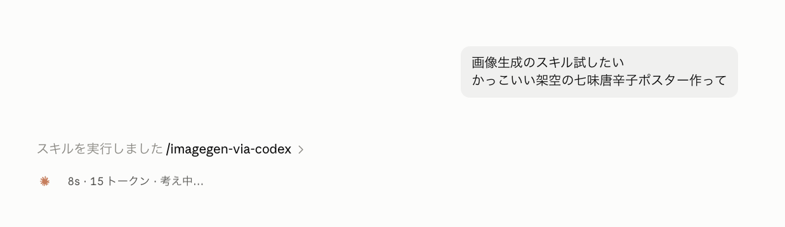
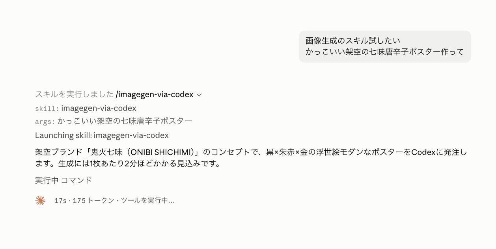
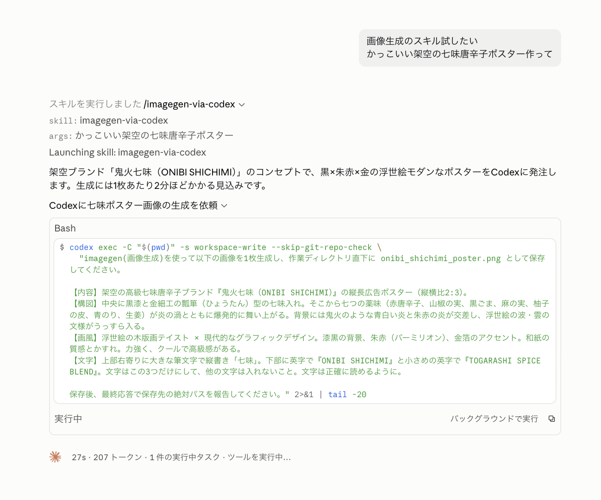
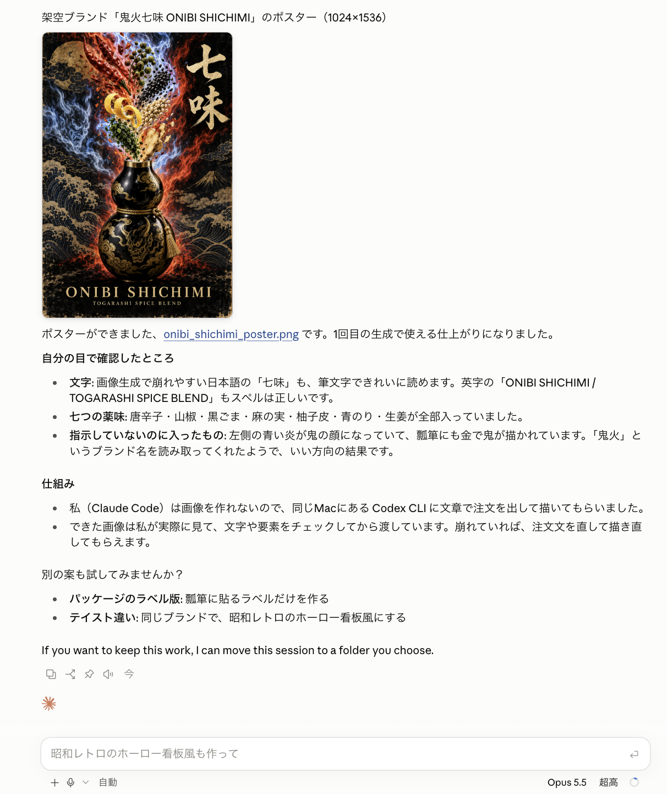
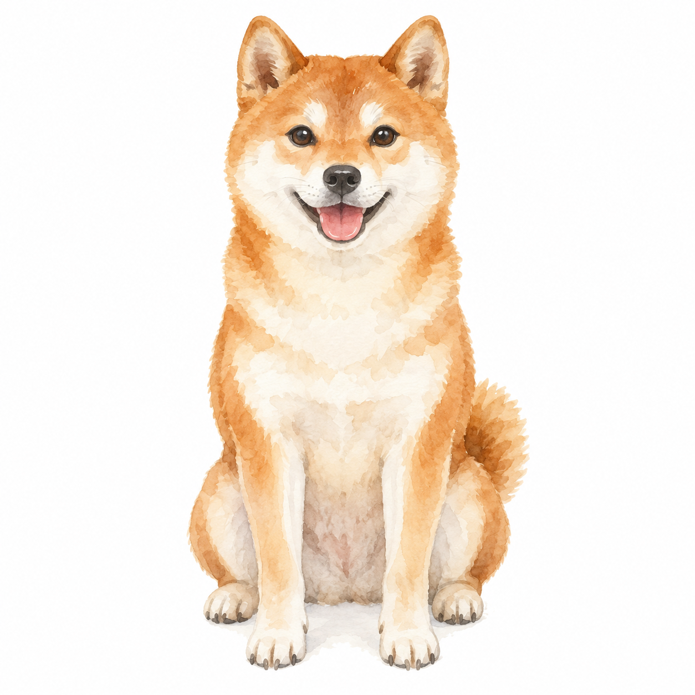
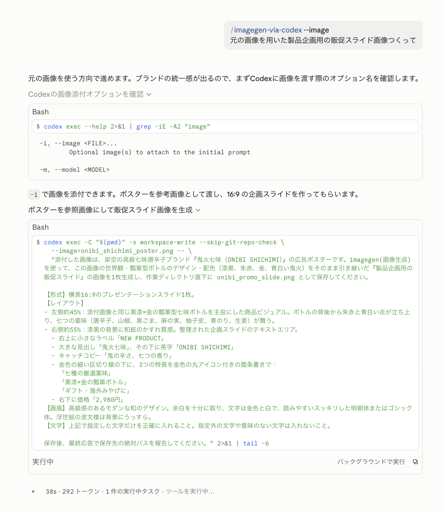
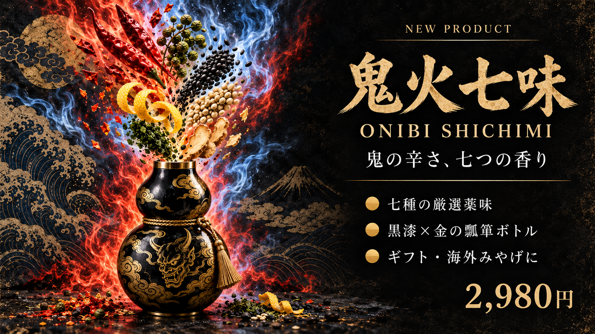

# imagegen-via-codex

English | [日本語](README.ja.md)

A Claude Code skill that asks the Codex CLI to generate images, then has Claude open and check the result.

I made it so I could ask for illustrations and thumbnails without leaving Claude Code. Claude turns your request into a structured spec, hands it to Codex, opens the saved image, and asks for a fix if something doesn't match.

The skill is [SKILL.md](SKILL.md) plus one small helper ([scripts/trash_codex_copies.py](scripts/trash_codex_copies.py)) that cleans up the image copies Codex leaves behind. There is no server and no API-key management.

> **Note:** The skill instructions (SKILL.md) and the screenshots below are in Japanese. Claude reads the instructions as they are, whatever language you write your request in.

## Example: a poster for a fictional shichimi spice brand

These are screenshots from my own use. From this short request (in Japanese), Claude worked out the layout, colors and text, and asked Codex to generate the image.

> 画像生成のスキル試したい
> かっこいい架空の七味唐辛子ポスター作って
>
> *(I want to try the image generation skill. Make a cool poster for a fictional shichimi spice.)*

### You ask, and Claude picks the skill

The skill name was not given. Claude chose `imagegen-via-codex` on its own.



<details>
<summary>See what Claude planned and what it sent to Codex</summary>

Claude invented a brand, "ONIBI SHICHIMI", and shaped the request into an ukiyo-e style poster in black, vermilion and gold.



It put the composition, the seven spices, the background and the text into a prompt and sent it with `codex exec`.



The screenshots show the commands as they were at the time. See [SKILL.md](SKILL.md) for the current procedure.

</details>

### You get the image and Claude's check

The finished poster comes back with Claude's notes on the text and how the spices are drawn.



## Requirements

- Claude Code, able to run local commands and read images
- The Codex CLI, installed in the same environment and logged in
- An account and environment where Codex's built-in image generation tool is available
- An internet connection and a folder to save images in
- Python 3 (for the helper that cleans up the image copies Codex leaves behind; standard library only)

**Being able to log in to Codex is not the same as being able to use its image tool.** What's available depends on your account, settings and version. Installing this skill does not make image generation work everywhere.

This is a skill I use on macOS, published as is. It has not been tested on Windows or Linux. The commands below are for Bash or zsh on macOS.

## Install

First, run these in the terminal that Claude Code uses:

```bash
codex --version
codex login status
```

If `codex` is not found, install it by following the [Codex CLI guide](https://developers.openai.com/codex/cli/). If you are not logged in, run `codex login` (see the [authentication docs](https://developers.openai.com/codex/auth/)).

Then put this repository in your personal Claude Code skills folder. You need Git.

```bash
mkdir -p "$HOME/.claude/skills"
git clone https://github.com/mocchicc/imagegen-via-codex.git \
  "$HOME/.claude/skills/imagegen-via-codex"
```

If a folder with the same name already exists, this command fails. Don't delete the old skill; look at it first, then back it up or merge.

Without Git, you can download [SKILL.md](SKILL.md) and [scripts/trash_codex_copies.py](scripts/trash_codex_copies.py) and save them under `~/.claude/skills/imagegen-via-codex/` with the same layout. See the [Claude Code docs on skills](https://code.claude.com/docs/en/skills) for where skills go.

## Asking for an image in Claude Code

Ask like this:

```text
/imagegen-via-codex
Make a watercolor illustration of one shiba inu sitting and facing forward on a white background.
No text, logos or watermarks. Square, saved to images/shiba-watercolor.png.
```

If you just say "generate an image" without the skill name, Claude picks this skill when it fits. If it doesn't, name the skill as above.

To revise, name the file and what to change:

```text
Keep the shiba in images/shiba-watercolor.png as it is and make only the background pale blue.
Keep the original and save the result to images/shiba-watercolor-v2.png.
```

After Codex generates the image, Claude opens the saved file to check it, then cleans up the copy left on the Codex side (see [What Codex leaves behind](#what-codex-leaves-behind)). The result is saved as a file. Whether the image is shown in the conversation depends on the app you use.

This image was generated by sending the same request (written in Japanese) to the Codex CLI:



## Using an existing image as a reference

If you just say "use this product" or "base it on the original image", Claude may only describe the image in words to Codex. Describing "a black and gold gourd-shaped bottle" is not the same as handing over the product photo.

When you want Codex to look at the original, give the path of an image file Codex can read, and say what to carry over. An image attached to your Claude conversation is not forwarded to Codex automatically.

```text
/imagegen-via-codex
Pass images/onibi_shichimi_poster.png to Codex as a reference image
and make a promotional slide for product planning.
Keep the bottle's shape, decoration and colors, and make it a 16:9 landscape.
Keep the original and save to images/onibi_promo_slide.png.
```

You can tell that the image was attached if the `codex exec` command Claude runs includes `--image "/absolute/path/to/image.png"` or `-i "/absolute/path/to/image.png"`. Without it, Codex may still read the file on its own, but a product name or description in the prompt does not mean the image itself was passed.

In my own use, I passed the original poster as a reference and generated a landscape promo slide. The collapsed section shows the run with `--image=onibi_shichimi_poster.png`, and the finished image follows.

<details>
<summary>See the screen where the image is passed to Codex</summary>



The `/imagegen-via-codex --image` at the top is just the request to Claude; the skill has no special option handling. What matters is the `codex exec` command Claude builds and the image file it passes.

</details>

### Promo slide generated from the original poster

A landscape image that keeps the original poster's black and gold gourd bottle, red and blue flames and flying spices, with the product name, features and price on the right.



## How Claude builds the prompt

Even for a short request, Claude first organizes it into a spec with labeled items (use, subject, style, composition, text to include, things to leave out) and then sends it to Codex. The format follows the image skill bundled with Codex and [OpenAI's image generation prompting guide](https://developers.openai.com/cookbook/examples/multimodal/image-gen-models-prompting-guide).

- No tag soup like "8k, masterpiece"; visible details are written as plain sentences.
- No people, props or slogans you didn't ask for.
- Text to appear in the image is given verbatim in quotes.
- For revisions, Claude separates what to change from what to keep, restates what to keep every time, and changes one thing at a time.

## About the image model

This skill uses Codex's built-in image tool. **The service chooses the model, so the skill can't specify it.** OpenAI announced in September 2026 that GPT Images 2.5 would roll out to Codex, but you can't confirm locally which model produced an image.

If you want a fixed model such as `gpt-image-2.5-sunburst`, or a fixed quality or pixel size, you need a separate route with an API key (pay as you go). This skill never switches to it without your consent.

## Before you use it

### It uses both Claude and Codex quota

Codex does work on top of your conversation with Claude, and every revision adds to that usage. The skill is free, but the services are not.

The skill assumes Codex's built-in image tool. It has no steps for registering a separate image API key. Check your own plan and each service's current terms for pricing and limits. If image generation isn't available, it does not fall back to a paid API on its own.

### Requests and reference images are processed by outside services

Commands run locally, but image generation does not stay on your computer. Prompts and reference images are processed by OpenAI, and the images Claude checks are processed according to your Claude setup. Check your organization's rules and each service's settings before using customer data, personal information or unreleased material.

Codex starts with your local settings and permissions. `workspace-write` limits where Codex can write; it does not guarantee that Codex can't read files outside the working folder. If you have files that must not be shared, check the working folder and settings.

### Generation can take a few minutes

The skill tells Claude to wait up to 10 minutes per command. That doesn't mean it always finishes within 10 minutes.

The work may still be running after the wait ends. To avoid generating the same image twice, Claude checks the process and the save location before trying again.

### Check the image yourself at the end

Claude checks the image, but it may not catch every wrong character or odd detail. Look again at any Japanese text, the number of elements and fine shapes before using an image. Numbers and explanations in a diagram need checking separately from how it looks.

### Mind where it saves and overwriting

Giving a save location and file name makes the result easy to find. If you don't, Claude sets one up in the project you're working in. Revised versions are saved under a new name by default.

### What Codex leaves behind

Normally Codex saves each exchange as a conversation, with the generated image embedded in it. That can be several MB to tens of MB per call, so this skill calls `codex exec --ephemeral` to keep the conversation from being saved.

Codex still leaves a copy of each image in `~/.codex/generated_images/`. After checking the image, Claude uses the bundled `scripts/trash_codex_copies.py` to move only the copies that are byte-for-byte identical to the saved images into the macOS Trash. Nothing is deleted outright, so disk space comes back only after you empty the Trash. On shared machines, keep that in mind. If there is no Trash (`~/.Trash`), the helper stops without moving anything.

## Troubleshooting

| Problem | What to check |
| --- | --- |
| The skill isn't found | Check that `~/.claude/skills/imagegen-via-codex/SKILL.md` exists, then open a new Claude Code session. |
| `codex: command not found` | Check that `codex --version` works from the environment Claude Code uses. |
| Login errors | Check `codex login status` and run `codex login` yourself if needed. Don't paste credentials into chats or issues. |
| "The image tool isn't available" | Check whether Codex alone can generate the same image. Availability depends on CLI version, settings and account. |
| It can't save | Check that the folder exists and is writable. Options that turn off protections wholesale are not part of this skill's steps. |
| It timed out | Check whether the original run finished or already saved the image before running again. |
| Warnings or error-looking messages | Don't judge by the message alone; check the exit status and this run's output image. |

If that doesn't help, open an [issue](https://github.com/mocchicc/imagegen-via-codex/issues) with your OS, the Claude Code and Codex CLI versions, and what happened. If you paste logs, remove credentials, personal paths and anything private in your request.

## Testing notes

The original skill records a test on August 10, 2026 (macOS, Codex CLI 0.144.1): generating a watercolor shiba image and reading it from Claude.

On September 26, 2026 (macOS, Codex CLI 0.157.1, ChatGPT login), I tested the same `codex exec` call as the published version: one PNG from the built-in image tool, saved to the given path, then viewed and checked. The shiba image in the usage section is that output (1254 × 1254 px).

The same day, with the improved version that organizes prompts into labeled items, I generated a 16:9 watercolor (1672 × 941 px) and confirmed that the aspect ratio, number and position of subjects, empty space and no-text instruction were all followed.

On October 26, 2026 (macOS, Codex CLI 0.160.0), I tested calls with `--ephemeral`: one new image, one revision of a reference image passed with `--image`, and one batch of four images generated at once. Every image was saved to the given path, and nothing was left in Codex's conversation list, conversation records or history database. In the reference edit, only the time of day changed; the subject's shape, position and composition stayed the same. The remaining copies were moved to the Trash with `trash_codex_copies.py`, and copies whose contents differed from the saved files were left alone.

The poster and the promo slide made from it are examples from my own use, separate from the command tests above. I have not re-tested the full flow of invoking the published skill from Claude Code, or running it on Windows or Linux.

## License and status

Released under the [MIT License](LICENSE). You may copy, modify and redistribute the skill; keep the license and copyright notice when you do.

The license covers the skill and documents in this repository. For Claude, Codex and the images you generate, also check each service's terms.

This is an unofficial skill made by an individual. It is not provided or endorsed by Anthropic or OpenAI.
